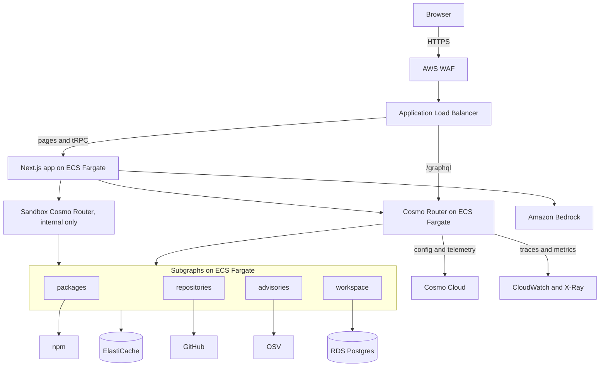

# Traverse

Explore a federated GraphQL graph from the frontend, built on [WunderGraph Cosmo](https://cosmo-docs.wundergraph.com/overview).

Traverse answers two questions for frontend developers: **which subgraphs does my query touch, and what breaks if this schema changes?**

> [!NOTE]
> **Status: early development.** Today the repository holds the specification and quality gates. Everything below is planned and not built yet. The first public release will be a demo and a CLI you can run on your own repository.

## What you'll be able to do

| Job                                      | How Traverse helps                                                                                                                       |
| ---------------------------------------- | ---------------------------------------------------------------------------------------------------------------------------------------- |
| Catch breaks in code that hasn't shipped | A CLI and GitHub Action read your repository's operations, compose your proposed schema, and comment on the pull request with what broke |
| Find who owns a field                    | Trace any field to its subgraph and owner                                                                                                |
| See a query's cost before shipping       | See the real query plan as a route: which subgraphs it hits, and in what order                                                           |
| Learn an unfamiliar graph                | Search a map of subgraphs, entities and owners                                                                                           |
| Vet a dependency                         | Paste a `package.json` to see licences, advisories and maintenance from live data                                                        |

It works on any Federation SDL, and the core needs no account and no AI.

## Why it's built on Cosmo

| Cosmo part                                                                           | What Traverse uses it for                                  |
| ------------------------------------------------------------------------------------ | ---------------------------------------------------------- |
| [`@wundergraph/composition`](https://www.npmjs.com/package/@wundergraph/composition) | Real federation composition, in the CLI and in the browser |
| [Cosmo Router](https://cosmo-docs.wundergraph.com/router/intro)                      | Serves the graph, and provides real query plans            |
| Cosmo Cloud and Studio                                                               | Schema registry, composition checks and analytics          |
| `wgc`                                                                                | Schema checks and publishing                               |

## How it fits with other tools

Traverse complements these tools, and doesn't replace them:

- **`wgc subgraph check`** compares a change with real traffic, 7 days by default. That can't see an operation on a feature branch, or one that runs rarely. Traverse reads the code.
- **Cosmo Studio and Hub** serve platform teams and schema governance. Traverse starts from the frontend: screen, operation, field, subgraph, owner.
- **[GraphQL Inspector](https://github.com/graphql-hive/graphql-inspector)** already validates operations against a schema. Traverse adds Cosmo's composition engine, subgraph and owner attribution, and screen mapping.

## Real data

The project's own graph serves live public data, joined across subgraphs:

| Subgraph       | Source   | Data                                        |
| -------------- | -------- | ------------------------------------------- |
| `packages`     | npm      | Versions, licences, dependencies, downloads |
| `repositories` | GitHub   | Stars, releases, owners                     |
| `advisories`   | OSV      | Known vulnerabilities                       |
| `workspace`    | Postgres | Your saved drafts and screen maps           |

## Planned architecture



An optional assistant on Amazon Bedrock explains results and suggests safe changes. Its suggestions run through real composition before you see them, and everything works without it.

## Planned stack

| Area           | Technology                                                 |
| -------------- | ---------------------------------------------------------- |
| Web app        | Next.js, React, TypeScript, Tailwind, Radix, tRPC, Zustand |
| Graph          | Cosmo Router, Cosmo Cloud, `@wundergraph/composition`      |
| Services       | TypeScript on Node 24, Postgres, Redis                     |
| AI             | Amazon Bedrock                                             |
| Infrastructure | AWS CDK, ECS Fargate, RDS, ElastiCache                     |
| Edge           | Route 53, AWS WAF, Application Load Balancer               |
| Observability  | OpenTelemetry, CloudWatch, X-Ray                           |
| Delivery       | GitHub Actions with OIDC                                   |

## Getting started

You need Node 24 and npm. These commands work today:

```sh
git clone https://github.com/ayenisholah/traverse.git
cd traverse
nvm use
npm ci
npm run check
```

`npm ci` also installs the Git hooks, and `npm run check` runs every quality gate.

## Roadmap

| Milestone | Outcome                                            | Status  |
| --------- | -------------------------------------------------- | ------- |
| M0        | Tooling, specification, quality gates              | Done    |
| M1        | Public demo and CLI, on real schemas               | Planned |
| M2        | Real graph behind the Cosmo Router                 | Planned |
| M3        | Live query routes and the Package explorer         | Planned |
| M4        | Accounts and saved workspaces                      | Planned |
| M5        | AI assistant on Amazon Bedrock                     | Planned |
| M6 to M8  | AWS network, services and observability            | Planned |
| M9 to M11 | Delivery pipeline, resilience proof and production | Planned |

## Documentation

- [Progress](docs/PROGRESS.md)
- [Specification](SPEC.md)
- [Requirements](docs/REQUIREMENTS.md)
- [Roadmap](docs/ROADMAP.md)
- [Architecture decisions](docs/adr/README.md)
- [Verified facts](docs/VERIFIED_FACTS.md)
- [Service level objectives](docs/SLOS.md)
- [Threat model](docs/THREAT_MODEL.md)

## Contributing

- Use one branch and one pull request per feature.
- `main` is protected, so all changes arrive through a pull request with passing checks, and land by rebase merge.
- Commits follow [Conventional Commits](https://www.conventionalcommits.org/) and each one is a single, complete change. A hook checks the format.
- New behaviour comes with tests in the same commit.

See [contributing](CONTRIBUTING.md) for details, and [security](SECURITY.md) to report a vulnerability.

## Licence

[MIT](LICENSE)

Traverse is an independent project and isn't affiliated with WunderGraph or AWS.
