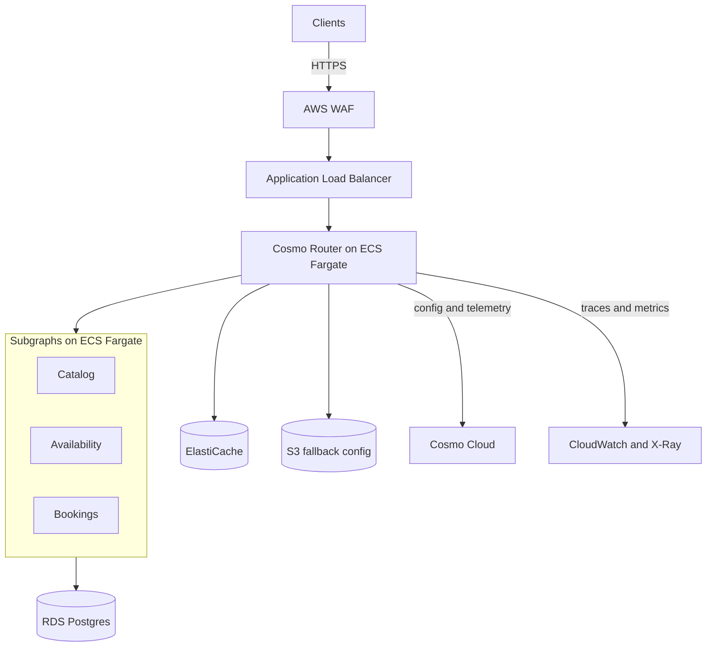

# Signalbox

Signalbox is a production-grade platform for running a federated GraphQL API on AWS. It runs a self-managed [Cosmo Router](https://cosmo-docs.wundergraph.com/router/intro) in front of independently deployed subgraphs, and uses Cosmo Cloud for the schema registry, analytics and Studio.

A signal box controls which route each train takes, and keeps trains on separate routes from colliding. Signalbox does the same job for API traffic: one controlled entry point that decides what may pass and where it goes.

The example domain is appointment booking, with fictional data throughout. The platform is the point of the project, so the patterns apply to any federated graph.

> [!NOTE]
> **Status: early development.** Today the repository contains the tooling and quality rules. The router, subgraphs and AWS infrastructure described below are planned and not built yet.

## Why it exists

Running a graph router in production involves more than starting a container. Signalbox aims to be a complete, tested answer to the harder questions:

- How do you deploy without dropping requests?
- What happens when the control plane is unreachable?
- How do you stop a schema change from breaking clients?
- How do you keep one tenant's data away from another?
- How do you trace a request from the load balancer to the database?

## Planned architecture



The router, subgraphs and data all run in your AWS account. Cosmo Cloud provides Studio, the schema registry and analytics.

## Design goals

- **Safe by default.** Production accepts approved operations only, and development features stay off.
- **Zero-downtime deploys.** Tasks drain before they stop, and failed releases roll back automatically.
- **Tenant isolation.** The tenant comes from a verified token, never from client input.
- **Observable.** Every request can be traced, and every alarm has a runbook.
- **Everything in code.** All infrastructure is defined in CDK, and deploys use short-lived credentials.

## Planned stack

| Area           | Technology                                   |
| -------------- | -------------------------------------------- |
| Graph          | Cosmo Router, Cosmo Cloud                    |
| Services       | TypeScript on Node 24, Postgres, Redis       |
| Infrastructure | AWS CDK, ECS Fargate, RDS, ElastiCache       |
| Edge           | Route 53, AWS WAF, Application Load Balancer |
| Observability  | OpenTelemetry, CloudWatch, X-Ray             |
| Delivery       | GitHub Actions with OIDC                     |

## Getting started

You need Node 24 and npm. These commands work today:

```sh
git clone https://github.com/ayenisholah/signalbox.git
cd signalbox
nvm use
npm ci
```

`npm ci` also installs the Git hooks.

| Command                 | What it does                             |
| ----------------------- | ---------------------------------------- |
| `npm run format:check`  | Checks formatting with Prettier          |
| `npm run lint`          | Runs ESLint                              |
| `npm run typecheck`     | Type-checks the project                  |
| `npm test`              | Runs the tests                           |
| `npm run test:coverage` | Runs the tests with a 100% per-file gate |

There's no application code or tests yet, so the test commands pass with nothing to run.

## Roadmap

| Phase            | Outcome                                                 | Status      |
| ---------------- | ------------------------------------------------------- | ----------- |
| Foundation       | Tooling, specification, quality gates                   | In progress |
| Local graph      | Three subgraphs running behind the router locally       | Planned     |
| Network and data | VPC, databases and edge in CDK                          | Planned     |
| Services         | Router and subgraphs on a staging environment           | Planned     |
| Observability    | End-to-end traces, dashboards and alarms                | Planned     |
| Delivery         | Schema checks and automated, reversible deploys         | Planned     |
| Resilience       | Load, failover and recovery tests with recorded results | Planned     |
| Production       | Launch with runbooks and a cost baseline                | Planned     |

## Contributing

- Use one branch and one pull request per feature.
- `main` is protected, so all changes arrive through a pull request and land by rebase merge.
- Commits follow [Conventional Commits](https://www.conventionalcommits.org/) and each one is a single, complete change. A hook checks the format.
- New behaviour comes with tests in the same commit.

## Licence

[MIT](LICENSE)

Signalbox is an independent project and isn't affiliated with WunderGraph or AWS.
