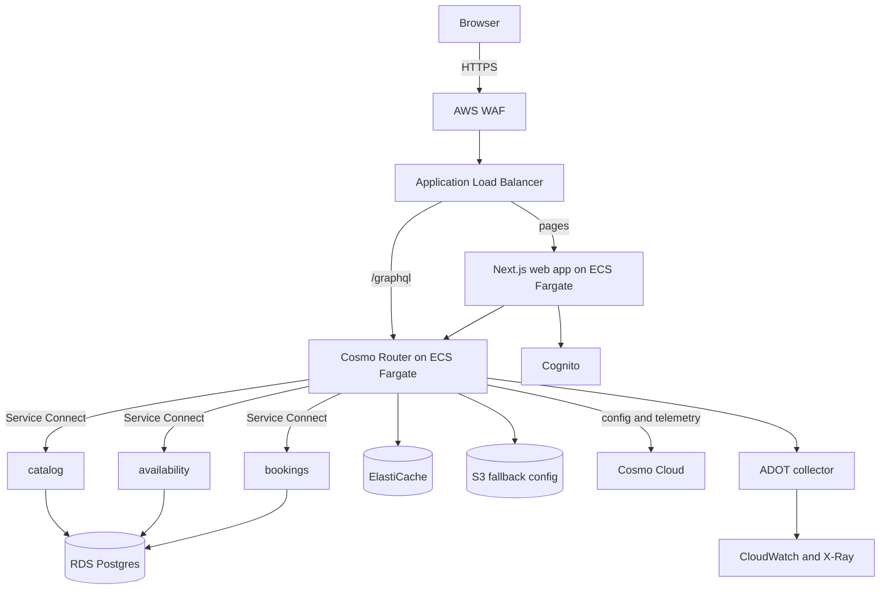

# Traverse specification

**Status:** Draft v1 · **Updated:** 2026-11-05

Traverse is a booking web app built on a federated GraphQL API. Customers browse services, choose a slot and manage bookings in a Next.js app, which talks to a self-managed Cosmo Router in front of independently deployed subgraphs on AWS. This document describes the target system. [Requirements](docs/REQUIREMENTS.md) define what must be true and how it's checked, and the [roadmap](docs/ROADMAP.md) shows what's built.

## Goals

- Give customers a fast, accessible way to find a slot and book it.
- Serve one graph through a single hardened entry point.
- Deploy any subgraph or the router without failed requests.
- Keep serving when Cosmo Cloud is unreachable.
- Stop breaking schema changes before they merge.
- Isolate tenants by a verified identity.
- Trace any request from the load balancer to the database.
- Define all infrastructure in reviewed, tested code.

## Non-goals

- Multi-region failover.
- Self-hosting the Cosmo control plane.
- Real customers or businesses. Booking data is fictional.
- Payments and notifications.
- A native mobile app.

## Architecture



| Component                 | Responsibility                                                          |
| ------------------------- | ----------------------------------------------------------------------- |
| AWS WAF                   | Managed rule groups and a coarse rate rule at the edge                  |
| Application Load Balancer | TLS termination, target health, access logs                             |
| Cosmo Router              | JWT validation, persisted operations, limits, query planning, telemetry |
| Subgraphs                 | Business rules and data for one domain each                             |
| RDS Postgres              | Durable data, one schema per subgraph                                   |
| ElastiCache               | Router rate-limit counters                                              |
| S3                        | Fallback router configuration                                           |
| Cosmo Cloud               | Schema registry, composition, config delivery, Studio analytics         |
| ADOT collector            | Sends traces and metrics to AWS                                         |

### Environments

| Environment | Purpose                                    | Shape                                       |
| ----------- | ------------------------------------------ | ------------------------------------------- |
| Local       | Development and end-to-end tests           | Docker Compose with the pinned router image |
| Staging     | Proving changes, load and resilience tests | Same stacks, smaller, single NAT gateway    |
| Production  | Live traffic                               | 3 Availability Zones, Multi-AZ data stores  |

### Router sizing

Production starts with 3 tasks of 2 vCPU and 4 GB, and scales to 9 on CPU and requests per target. Tasks share their resources with the Service Connect proxy and the ADOT sidecar, so load tests confirm the final size.

### Shutdown timing

| Setting                  | Value | Reason                                                       |
| ------------------------ | ----- | ------------------------------------------------------------ |
| `SHUTDOWN_DELAY`         | 90s   | Total time for drain and shutdown                            |
| `DRAIN_PERIOD`           | 65s   | Longer than the 60-second load balancer idle timeout         |
| `GRACE_PERIOD`           | 20s   | Time to finish in-flight requests                            |
| ALB deregistration delay | 90s   | Matches the router's shutdown                                |
| ECS `stopTimeout`        | 120s  | The Fargate maximum, so the router is never killed mid-drain |

## Web app

A Next.js app in `apps/web`, rendered on the server.

| Route                   | Purpose                                        |
| ----------------------- | ---------------------------------------------- |
| `/`                     | Services for the signed-in customer's business |
| `/services/[id]`        | Choose a date and slot, then book              |
| `/bookings`             | View and cancel bookings                       |
| `/sign-in`, `/sign-out` | Cognito sign-in and sign-out                   |

- The server holds the session and calls the router, so browser code never handles tokens (GR-9).
- Operations are written as `.graphql` documents, which generate typed clients and the persisted operation list (FR-WEB-6).
- Every data view has loading, empty and error states.
- The design system uses semantic tokens generated from one source, rem sizing and AA contrast in light and dark themes.

## Interfaces

### Public API

- `POST /graphql` over HTTPS, for persisted operations only. The load balancer routes this path to the router for API clients; the web app reaches the router internally.
- Requests carry `Authorization: Bearer <JWT>`.
- `/health/ready` and `/health/live` serve the load balancer and the platform, and aren't public API.

### Identity

Tokens are issued by a Cognito user pool. A token carries a `business_id` claim, which is the only source of tenant identity. The router validates each token. Subgraphs verify it again against the same keys, so a subgraph never trusts a caller for tenant identity.

### Graph

```graphql
# catalog
type Business @key(fields: "id") {
  id: ID!
  name: String!
  timezone: String!
}

type Service @key(fields: "id") {
  id: ID!
  name: String!
  durationMinutes: Int!
  priceCents: Int!
}

type Query {
  services: [Service!]!
}

# availability
type Slot @key(fields: "id") {
  id: ID!
  startsAt: DateTime!
  endsAt: DateTime!
}

extend type Service @key(fields: "id") {
  id: ID! @external
  slots(date: Date!): [Slot!]!
}

# bookings
enum BookingStatus {
  CONFIRMED
  CANCELLED
}

type Booking @key(fields: "id") {
  id: ID!
  status: BookingStatus!
  slot: Slot!
  service: Service!
}

extend type Service @key(fields: "id") {
  id: ID! @external
  bookings: [Booking!]!
}

type Mutation {
  createBooking(slotId: ID!, serviceId: ID!, idempotencyKey: ID!): Booking!
  cancelBooking(bookingId: ID!): Booking!
}
```

No operation accepts a business ID as an argument. This schema is a design sketch, and M1 confirms it against composition.

## Data model

Each subgraph owns its tables, and no subgraph reads another's schema.

| Subgraph       | Tables                  | Rules                                                                                                     |
| -------------- | ----------------------- | --------------------------------------------------------------------------------------------------------- |
| `catalog`      | `business`, `service`   | Prices are integer cents                                                                                  |
| `availability` | `opening_hours`, `slot` | Timestamps are UTC, shown in the business timezone                                                        |
| `bookings`     | `booking`               | One active booking per slot, enforced by a partial unique index; `idempotency_key` is unique per business |

Every table carries `business_id` and an index on it.

## Delivery

Pull requests run every quality gate, `cdk diff` and `wgc subgraph check`. Merging to `main` deploys staging and runs smoke tests. Production waits for an approval.

Each release runs in this order, so the router never receives a schema ahead of the code:

1. Run database migrations.
2. Deploy subgraphs.
3. Publish schemas to Cosmo Cloud.

## Success criteria

- All requirements are `done`, with recorded verification.
- A rolling deploy under load produces no 5xx responses.
- With the Cosmo CDN blocked, running tasks and new tasks serve the last good configuration.
- Measured recovery meets the targets in [SLOs](docs/SLOS.md).
